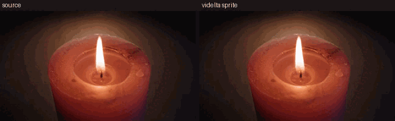

# videlta

Turns a video into one base frame plus numbered PNG frames that hold only the
pixels that changed since the previous frame. Draw the base, stack the deltas,
and you get the video back.

This is the old pixel-game trick. It works well when a video is mostly static:
a character moves over a fixed background, a title card sits still, a camera is
locked off. On a noisy or fast-moving video the deltas approach full frames and
the size advantage disappears.

## Demo

Left is the source clip. Right is the same clip rebuilt by stacking the base
frame and every delta PNG in order (game-style sprite playback).



First 3 seconds of the sample candle clip, 10 fps, 320 px wide.

Source video by [jrydertr](https://pixabay.com/users/jrydertr-29142268/) from
[Pixabay](https://pixabay.com/videos/candlelight-candle-flame-light-123824/)
(Content License). Demo files live in `demo/`.

## Build

```
odin build . -o:speed
```

You need an Odin compiler to build it and `ffmpeg` and `ffprobe` on `PATH` at
runtime. The program spawns ffmpeg to decode and pipe raw `rgb24` frames; it
does its own diffing and writes PNG/JPEG with `vendor:stb/image`. Optional
`-optimize` needs ImageMagick `magick`, and `cjpeg` (libjpeg-turbo) when the
base frame is `0.jpg`.

## Usage

```
videlta input.mp4 [options]
```

Common cases:

```
videlta clip.mp4
videlta clip.mp4 -bg 00ff00 -fps 12
videlta clip.mp4 -o frames/ -threshold 4 -verify
videlta clip.mp4 -fps 10 -lossless -optimize -verify
```

Options:

| Flag | Meaning |
| --- | --- |
| `-o, --out DIR` | Output directory. Default is `<input>_frames` next to the input. |
| `-bg, --bg COLOR` | Background color to key out: `#RRGGBB`, `RRGGBB`, or `R,G,B`. |
| `-fps, --fps RATE` | Resample to RATE fps: `12`, `29.97`, or `30000/1001`. Default keeps source frames. |
| `-threshold N` | Per-channel change threshold, 0 to 255. Default 8, 0 means exact. |
| `-bg-tol N` | Background key tolerance, 0 to 255. Default 16. |
| `-jpgq N` | JPEG quality for `0.jpg`, 1 to 100. Default 90. |
| `-lossless` | Without `-bg`, write an opaque `0.png` instead of a lossy `0.jpg`. |
| `-optimize` | Smaller files, same pixels. ImageMagick lossless PNG recompress on every PNG; `cjpeg -optimize` for `0.jpg` when the base is JPEG. Needs `magick`; needs `cjpeg` only for `0.jpg`. |
| `-verify` | Decode the written files, composite them, compare against the source. |
| `-force` | Replace a non-empty output directory. |
| `-v, --verbose` | Print one line per frame. |
| `-V, --version` | Print the version. |
| `-h, --help` | Show help. |

## Output

Frame 0 is the base. Without `-bg` it is `0.jpg`. With `-bg` it is `0.png` with
the keyed background transparent. The rest are `1.png`, `2.png`, and so on, at
the source resolution and frame rate after any `-fps` resampling.

Each delta PNG starts from the previous composited state and changes only the
pixels whose red, green, or blue channel differs by more than `-threshold`.
Everything else is fully transparent, alpha 0. Pixels at or under the threshold
stay transparent on purpose, so a small amount of video noise does not turn every
frame into a full-frame copy. Compositing 0, 1, 2, 3 in order on one canvas
replays the video. You never blend; just paint each delta over the canvas,
skipping transparent pixels.

With `-bg`, a pixel within `-bg-tol` of the background color is snapped to the
exact background color before diffing. That repaints old content in keyed areas
with the background instead of leaving stale pixels from an earlier frame. This
matters when a green-screen subject leaves an area and the next frame has to
clear it.

## The JPEG base caveat

`0.jpg` is lossy. The encoder round-trips every pixel in the base, and different
JPEG decoders disagree slightly about how to do that. In testing, comparing our
own decode against ffmpeg's decode showed differences up to about 150 on sharp
edges, enough to put visible mistakes in the reconstructed video even though
each delta is within `-threshold` of the source.

So if exactness matters, use either:

- `-lossless`, which writes an opaque `0.png` base. Requires more disk for
  frame 0, usually worth it.
- `-bg`, which already writes a PNG base.

The lossy `0.jpg` default is fine for previewing when you can tolerate a little
error, and for keyed sprites where the base is small.

## Verifying

`-verify` runs a second decode pass. It reads the files back from disk,
composites them, and compares each result against the source frame. It prints
the worst per-channel error and whether that is within the allowed bound:

```
threshold + max(base decode error, bg tolerance)
```

Exit status is non-zero if the check fails. This catches off-by-one frame
mappings, alpha mistakes, and base encode problems. It does not tell you whether
the output looks good; that is still your eyes.

## Notes

Frame count follows the source. `-fps` uses ffmpeg's `fps` filter to resample,
so upsampling duplicates frames and the duplicated deltas come out empty
(0 changed pixels), which is expected.

Odd frame dimensions work. They must stay even for some codecs, not for this
tool since ffmpeg outputs whatever size the stream has.

The output directory must be empty or absent unless you pass `-force`, which
deletes and recreates it. This is deliberate: a stale `7.png` from an earlier
run would silently corrupt the sequence.

## Measured

640x360, 150 frames, 5 seconds at 30 fps: about 5.8 seconds end to end including
`-verify` on this machine. A green-screen clip with a moving 48x48 box produced
deltas of around 384 changed pixels per frame. Lossless runs reconstruct exactly;
keyed runs stay within the key tolerance.

Independent verification was done with a separate Python/Pillow compositor, not
with the program's own code. Lossless worst error equalled the threshold (8).
Keyed worst error stayed at the background tolerance. Mean error stayed under
0.3.

## Test media

Manual checks use a local `test/sample.mp4` download of the Pixabay candle clip
above. Files under `test/` stay gitignored. Files under `demo/` are tracked.

## License

MIT. Redistributing it, modified or not, means keeping the copyright notice and
the permission notice in the source. See `LICENSE`.
